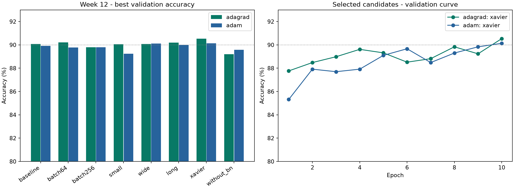

# 12주차 Fashion-MNIST Adam·AdaGrad 실험 정리

12주차까지의 수업 내용을 바탕으로 Adam과 AdaGrad의 학습 결과 비교. 최적화 방법, 가중치 초기화, 배치 정규화, 배치 크기, 은닉층 노드 수와 에폭의 영향 확인.

## 실험 조건과 비교 절차

- Fashion-MNIST 학습 데이터 60,000장을 학습 54,000장과 검증 6,000장으로 분리. 테스트 10,000장은 최종 평가에만 사용.
- 28×28 이미지를 784개 입력으로 변환하고 픽셀을 0~1로 정규화. 활성화 함수 ReLU 사용.
- 기준 구조는 `784 → 256 → 128 → 64 → 10`. 입력층 제외 4층으로 구성.
- 기준 배치 128, 최대 10에폭, He 초기화, 배치 정규화 사용. 학습률은 학습 중 일정하게 유지.
- 난수 시드 42, 동일한 데이터 분할 사용. 같은 구조와 배치의 두 방법은 동일한 초기 가중치와 미니배치 순서로 비교.
- 기준 조건에서 방법별 학습률 2개씩 비교하고, 검증 정확도가 높은 학습률을 이후 실험에 적용. 배치·노드·에폭·초기화·BN은 기준 조건에서 한 항목씩 변경.
- 학습률 비교 4회와 조건별 비교 14회로 총 18회 학습. 각 에폭의 검증 정확도를 기준으로 모델과 종료 시점 선택. 정확도 동률 시 검증 교차 엔트로피가 낮은 시점 선택.
- 선택 모델을 체크포인트로 저장하고 방법별로 한 번씩 테스트 평가. 최종 평가는 학습 54,000장으로 학습한 해당 체크포인트를 사용.

## 최적화 방법

| 방법 | 11~12주차 학습 내용 |
|---|---|
| AdaGrad | 기울기 제곱을 누적하고, 원소별 누적값에 따라 갱신 폭 조절 |
| Adam | 기울기와 기울기 제곱의 이동평균을 활용해 갱신 방향과 크기 조절 |

## 기준 조건의 학습률 비교

| 방법 | 학습률 | 최고 검증 정확도 | 선택 에폭 |
|---|---:|---:|---:|
| adagrad | 0.01 | 90.05% | 8 |
| adagrad | 0.025 | 90.07% | 10 |
| adam | 0.0003 | 89.92% | 10 |
| adam | 0.001 | 89.55% | 10 |

## 사용자가 변경하는 설정별 비교

아래 수치는 각 조건의 최고 검증 정확도이며 괄호 안은 해당 에폭. 방법별 학습률은 위 기준 조건의 선택값을 유지.

| 변경 조건 | AdaGrad | Adam |
|---|---:|---:|
| 기준 | 90.07% (10에폭) | 89.92% (10에폭) |
| 배치 64 | 90.22% (10에폭) | 89.78% (10에폭) |
| 배치 256 | 89.80% (8에폭) | 89.80% (8에폭) |
| 노드 128 → 64 | 90.05% (7에폭) | 89.23% (9에폭) |
| 노드 512 → 256 | 90.07% (8에폭) | 90.12% (9에폭) |
| 20에폭 | 90.20% (15에폭) | 90.00% (13에폭) |
| Xavier 초기화 | 90.53% (10에폭) | 90.13% (10에폭) |
| BN 미사용 | 89.20% (8에폭) | 89.58% (10에폭) |

배치 크기를 바꾼 실험은 에폭 수를 같게 유지. 따라서 한 번 본 데이터 양은 같지만 가중치 갱신 횟수는 서로 다름. 초기화와 BN 비교는 배치 128, 기준 구조, 10에폭으로 수행.



## 방법별 선택 모델의 최종 평가

| 방법 | 선택 조건 | 은닉층 노드 수 | 배치 | 학습률 | 선택 / 최대 에폭 | 검증 정확도 | 테스트 정확도 |
|---|---|---|---:|---:|---:|---:|---:|
| AdaGrad | Xavier 초기화 | 256 → 128 → 64 | 128 | 0.025 | 10 / 10 | 90.53% | **89.07%** |
| Adam | Xavier 초기화 | 256 → 128 → 64 | 128 | 0.0003 | 10 / 10 | 90.13% | **88.50%** |

방법별 최종 모델은 각각의 검증 결과로 선택하므로 서로 다른 설정일 수 있음. 최적화 방법 자체의 비교는 앞의 동일 조건 표를 기준으로 해석.

## 결과 해석

조건별 검증 비교 8개 중 AdaGrad가 높은 경우는 5개. 이번 데이터 분할, 학습률 후보, 초기화, 학습 기간에서 얻은 결과로 해석. 단일 난수 시드 실험이므로 반복 실행에 따른 편차는 추가 확인 필요.

배치 크기, 에폭, 노드 수, 초기화와 BN의 설정별 차이를 확인하고 검증 결과로 선택. 테스트 점수는 설정 선택을 마친 뒤 방법별 선택 모델을 최종 평가한 값.

## 실행 및 사용자 설정

저장소 루트에서 전체 비교를 실행.

```bash
python fashion/12주차_Adam_AdaGrad_비교.py
```

입력한 한 가지 구조와 배치에서 두 방법의 학습률만 비교하는 실행.

```bash
python fashion/12주차_Adam_AdaGrad_비교.py --mode single --hidden 256 128 64 --batch-size 128 --epochs 20 --init he --batchnorm 1 --adagrad-lrs 0.01 0.025 --adam-lrs 0.0003 0.001
```

| 옵션 | 기본값 | 사용자가 정하는 범위 |
|---|---|---|
| `--mode` | `study` | `study` 전체 비교, `single` 입력 조건 비교 |
| `--hidden` | `256 128 64` | 은닉층 1~5개, 층별 양의 정수 노드 수 |
| `--batch-size` | `128` | 2 이상의 정수, 마지막 배치도 2장 이상 |
| `--epochs` | `10` | 양의 정수. 전체 비교의 장기 후보는 입력값의 2배 |
| `--init` | `he` | `he`, `xavier`, `0.01` |
| `--batchnorm` | `1` | `1` 사용, `0` 미사용 |
| `--adagrad-lrs` | `0.01 0.025` | AdaGrad의 양의 학습률 목록 |
| `--adam-lrs` | `0.0003 0.001` | Adam의 양의 학습률 목록 |
| `--data-dir` | 저장소의 데이터 경로 | Fashion-MNIST 압축 파일 4개가 있는 폴더 |
| `--output-dir` | `fashion/results_adam_adagrad_week12` | 결과와 모델을 저장할 폴더 |

기본 출력은 1에폭마다 손실, 학습 표본 2,000장의 정확도, 검증 6,000장의 정확도 표시. 출력의 CE는 분류 교차 엔트로피. 결과 폴더에 방법별 선택 모델, 검증 기록, 최종 결과 JSON과 그래프 저장.

## 소스 및 원시 결과

- 실행 코드 · [12주차 Adam·AdaGrad 비교](fashion/12주차_Adam_AdaGrad_비교.py)
- 공통 학습 함수 · [NeuralNet_fashion.py](fashion/NeuralNet_fashion.py)
- 전체 실험 수치 · [Adam_AdaGrad_12주차_results.json](Adam_AdaGrad_12주차_results.json)
