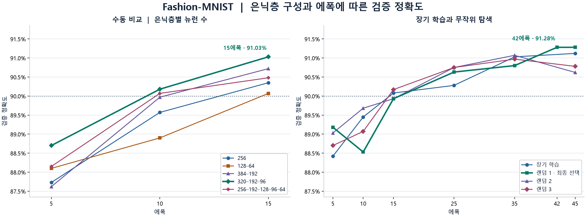

# 6조 Fashion-MNIST 분류 실험

Fashion-MNIST 의류 이미지 10종을 분류하는 완전연결 신경망 구현. 28×28 이미지를 784개 입력값으로 펼쳐 사용. 입력층을 제외하고 출력층까지 최대 6층으로 구성. 최종 모델의 **테스트 정확도는 90.86%**로, 목표인 90%를 달성함. 이전 3층 모델의 87.10%에서 **3.76%p** 향상.

## 실험 방법

- 원래 학습 데이터 60,000장을 학습용 54,000장과 검증용 6,000장으로 분리. 픽셀 값은 0~1로 정규화.
- 후보 간 비교를 위해 배치 크기를 256으로 통일. 학습용 54,000장 기준 에폭당 211회 가중치 갱신. ReLU, He 초기화, Adam, 배치 정규화, 드롭아웃, L2 정규화를 사용.
- 수동 실험에서는 은닉층 수와 각 층의 뉴런 수를 바꿔 후보 5개를 15에폭씩 학습. 수동 실험에서 가장 높은 점수를 기록한 구조는 45에폭까지 학습.
- 무작위 탐색에서는 같은 깊이에서 층별 뉴런 수, 학습률, L2 강도, 드롭아웃 비율을 바꾼 후보 3개를 45에폭씩 학습.
- 각 후보의 에폭별 검증 정확도로 모델과 종료 에폭을 선택. 선택이 끝난 뒤 학습 데이터 60,000장으로 다시 학습하고, 별도의 테스트 데이터 10,000장을 한 번 평가.

## 후보별 실험 결과

| 실험 | 은닉층 뉴런 수 | 전체 층 수¹ | 최고 점수 에폭 / 학습 에폭 | 최고 검증 정확도 |
|---|---|---:|---:|---:|
| 수동 1 | 256 | 2 | 15 / 15 | 90.35% |
| 수동 2 | 128 → 64 | 3 | 15 / 15 | 90.07% |
| 수동 3 | 384 → 192 | 3 | 13 / 15 | 90.72% |
| 수동 4 | 320 → 192 → 96 | 4 | 15 / 15 | 91.03% |
| 수동 5 | 256 → 192 → 128 → 96 → 64 | 6 | 15 / 15 | 90.48% |
| 장기 학습 | 320 → 192 → 96 | 4 | 34 / 45 | 91.27% |
| **랜덤 1 · 최종 선택** | **480 → 288 → 144** | **4** | **42 / 45** | **91.28%** |
| 랜덤 2 | 320 → 192 → 96 | 4 | 35 / 45 | 91.07% |
| 랜덤 3 | 320 → 192 → 96 | 4 | 43 / 45 | 91.25% |

¹ 입력층을 제외한 은닉층과 출력층의 합.



## 은닉층 수와 뉴런 수를 선택한 이유

**은닉층 수**는 15에폭 수동 비교로 결정. 은닉층 3개를 둔 `320 → 192 → 96` 모델이 91.03%로 수동 후보 중 가장 높았으며, 은닉층 5개를 둔 모델은 90.48%를 기록. 이 결과를 바탕으로 장기 학습과 무작위 탐색에서는 은닉층 3개를 유지.

**뉴런 수**는 같은 깊이에서 폭을 바꿔 비교. 은닉층 2개인 후보에서 `128 → 64`는 90.07%, `384 → 192`는 90.72%를 기록. 최종 탐색에서는 은닉층 3개의 폭을 `320 → 192 → 96`에서 `480 → 288 → 144`로 늘린 설정이 42에폭에서 최고 검증 정확도 91.28%를 기록. 해당 후보는 학습률과 정규화 설정도 함께 달랐으며, 장기 학습 후보와의 차이는 검증 이미지 한 장에 해당. 이번 실험의 검증 정확도를 기준으로 최종 구조와 에폭을 선택.

## 에폭 수를 선택한 이유

**45에폭**은 15에폭 수동 비교 이후에도 검증 정확도가 더 오르는지 확인하기 위한 탐색 상한으로 설정. 장기 학습과 무작위 탐색 후보에 같은 상한을 적용해 에폭별 검증 정확도를 비교.

장기 학습 후보는 **34에폭**에서 검증 정확도 **91.27%**로 최고점을 기록. 최종 후보는 **42에폭**과 **45에폭**에서 검증 정확도 **91.28%**로 같았으며, 검증 손실이 더 낮은 **42에폭**을 선택. 전체 학습 데이터로 다시 학습할 때는 45에폭 기준의 학습률 감소 방식을 유지하고 42에폭에서 종료.

## 최종 평가

최종 구조는 **`784 → 480 → 288 → 144 → 10`**. 은닉층 3개와 출력층 1개로 구성했으며, 전체 학습 데이터로 **42에폭** 학습.

| 지표 | 결과 |
|---|---:|
| 모델 선택 당시 검증 정확도 | 91.28% |
| 전체 데이터로 재학습한 뒤 학습 정확도 | 99.41% |
| 최종 테스트 정확도 | **90.86% (9,086 / 10,000)** |
| 최종 테스트 손실 | 0.3910 |

## 실행 방법

저장소 루트에서 아래 명령을 실행함. 데이터는 `Fashion_mnist/data/fashion/`의 압축 파일 4개를 사용.

```bash
python -m pip install numpy matplotlib
```

### 개별 실험

`수동1.py~수동5.py`, `자동1.py~자동3.py`, `장기학습.py`는 표에 나온 설정 중 해당 후보 하나를 학습함. `자동1.py`~`자동3.py`는 표의 랜덤 1~3에 해당함. 에폭과 배치 크기는 실행 옵션으로 변경 가능함.

```bash
python fashion/수동1.py
python fashion/수동2.py --batch-size 128 --epochs 20
python fashion/자동1.py
```

### L2·드롭아웃 미적용 비교

```bash
python fashion/L2_드롭아웃_미적용.py
```

`자동1.py`와 같은 4층 구조, 학습률, 배치 정규화, 데이터 분할을 사용하고 L2 계수와 드롭아웃 비율만 0으로 설정. 두 파일 모두 기본 배치 크기 256, 최대 45에폭으로 학습하며, 1에폭마다 점수와 마지막에 최고 검증 정확도를 출력함. 에폭과 배치 크기를 변경해 비교할 때는 두 파일에 동일한 옵션을 적용.

### CMD에서 설정 직접 입력

```bash
python fashion/실험설정.py
```

은닉층 수(1~5개), 층별 노드 수, L2 계수, 드롭아웃 비율, 배치 크기, 에폭, 초기 학습률, 출력 간격을 순서대로 입력함. 노드 수는 `480 288 144`처럼 공백 또는 쉼표로 구분함. 출력 간격은 `1` 또는 Enter로 **1에폭마다**, `2`로 **50배치마다** 선택함. 50배치 단위 선택 시 마지막 배치에서도 점수를 출력함.

### 자동 탐색 및 최종 평가

```bash
python fashion/자동.py
python fashion/자동.py --full-search
```

`자동.py`는 수동 4의 구조를 기준으로 무작위 후보를 비교한 뒤 선택 모델을 최종 평가함. `--full-search`를 지정하면 위 실험표의 수동 비교, 장기 학습, 무작위 탐색과 최종 평가를 모두 재현함. 공통 함수는 `NeuralNet_fashion.py`에 모아 둠.

기본 출력 간격은 1에폭이며, 학습 중 손실, 학습 표본 정확도, 검증 정확도를 출력함. 모델 선택에는 출력 간격과 관계없이 매 에폭 마지막의 검증 점수를 사용함. 개별 실험과 직접 설정 실행은 검증 결과와 그래프를 표시함. 자동 탐색은 후보 선택과 재학습을 마친 뒤 테스트 정확도를 출력함.

## 출처

- 데이터 및 IDX 읽기 방식 · [Zalando Research Fashion-MNIST](https://github.com/zalandoresearch/fashion-mnist)
- `common/` 교재 모듈 · [밑바닥부터 시작하는 딥러닝](https://github.com/oreilly-japan/deep-learning-from-scratch), [MIT 라이선스](common/LICENSE.md)
