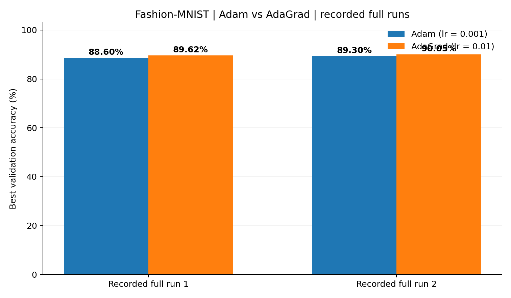

# Optimizer 비교 실험 정리 — `optimizer_compare.py`

> 6조 Fashion-MNIST 추가 실험. **이 문서의 정확도는 검증 정확도이며 테스트 정확도가 아닙니다.**  
> 코드 기준: `fashion/optimizer_compare.py`. 실행 결과 수치는 이전에 공유된 정식 실행 결과 두 건을 요약했습니다. 에폭별 원본 CSV는 이 보고서 작성 시 제공되지 않아, 비교 그래프는 **최고 검증 정확도 요약**만 시각화했습니다.

## 1. 실험 목적

- 완전연결 신경망의 **구조, 초기 가중치, 미니배치 순서, 데이터 분할**을 동일하게 유지하면서 Adam과 AdaGrad의 결과를 비교한다.
- Fashion-MNIST에서 AdaGrad를 추가 실험에 활용할 가능성을 확인한다.
- 공용 학습 코드를 수정하지 않고 비교용 코드를 별도로 실행한다.

## 2. 코드 구성과 비교 방법

| 항목 | 설정 / 구현 |
|---|---|
| 데이터 | 공식 Fashion-MNIST 훈련 원본 60,000장만 사용, 이미지 28×28을 784차원으로 펼쳐 0~1 정규화 |
| 분할 | 클래스별로 나눠 학습 **54,000장** / 검증 **6,000장**; 난수 시드 42 |
| 신경망 | `784 → 480 → 288 → 144 → 10` (은닉층 3개) |
| 활성화 / 초기화 | ReLU / He 초기화 |
| 배치 정규화 | ON |
| Dropout / L2 | 모두 OFF (두 Optimizer에 동일하게 적용) |
| 기본 학습 횟수 | `--full` 실행 시 10에폭 |
| 기본 배치 크기 | **256** (`--batch-size` 인자로 변경 가능) |
| 초기 가중치 / 미니배치 | 동일한 시드로 각각 생성하며, 미니배치 셔플 순서도 동일하게 사용 |
| Optimizer별 학습률 | Adam `0.001`, AdaGrad `0.01` (학습률 자체는 서로 다름) |
| 평가 지표 | 검증 정확도, 검증 교차 엔트로피(CE), 학습 표본 2,000장 정확도·CE |
| 테스트 데이터 | **사용하지 않음** |

코드 내부의 `make_network()`가 동일한 초기 가중치를 만들고, `run_one()`은 같은 시드의 미니배치 순서를 사용합니다. `metrics()`는 BatchNorm 통계가 변하지 않는 **추론 모드**에서 검증합니다. 원본 Fashion-MNIST 파일의 MD5와 크기도 검사합니다.

**비교 범위:** 동일한 것은 네트워크 구조와 훈련 절차이지, Adam과 AdaGrad의 **학습률 값**은 아닙니다. 따라서 특정 학습률 조합 아래에서 얻은 결과이지 두 최적화 알고리즘의 일반적인 우열을 증명하지 않습니다.

## 3. 실행 방법

저장소 루트(`C:\Neural_Net\team_github`)의 터미널에서 실행합니다.

```powershell
python fashion/optimizer_compare.py --full
```

기본은 **10에폭·배치 256**입니다. 단축 동작 점검은 다음과 같습니다.

```powershell
python fashion/optimizer_compare.py
```

`--full`이 없으면 학습 5,000장·검증 1,000장·2에폭으로 실행하는 **동작 검사**이므로 최종 성능 보고에 혼용하지 않습니다. 사용자가 `--batch-size`나 `--epochs`를 명시한 실행은 그 인자를 그대로 기록해야 합니다.

## 4. 실험 결과

이전에 공유한 정식 실행 두 건의 **최고 검증 정확도**를 정리했습니다.

| 구분 | Adam | AdaGrad | AdaGrad − Adam |
|---|---:|---:|---:|
| 정식 실행 1 | 88.60% | **89.62%** | +1.02%p |
| 정식 실행 2 | 89.30% | **90.05%** | +0.75%p |



**그래프 설명:** 앞서 공유된 최고 검증 정확도 두 쌍만 그린 요약 그림입니다. 에폭별 곡선, 손실 곡선, 재현성 실험 그래프가 아닙니다. **두 실행의 정확한 명령행 인자 및 CSV가 확보되지 않아**, 서로 완전히 동일한 조건의 반복인지 검증하지 못했습니다. 이 숫자를 통계적 유의성의 근거로 사용하지 않습니다.

### 코드가 자동 생성하는 원본 결과 파일

정식 실행을 마치면 `fashion/optimizer_results/full_날짜시각/` 아래에 다음을 저장합니다.

| 파일 | 용도 |
|---|---|
| `optimizer_results.csv` | 에폭별 train/validation 정확도·CE, 배치 크기, 학습률, 에폭 소요 시간 |
| `validation_accuracy.png` | Adam과 AdaGrad의 에폭별 검증 정확도 곡선 |
| `validation_loss.png` | Adam과 AdaGrad의 에폭별 검증 손실 곡선 |

실제 실행 조건·에폭별 변화를 보다 정확히 보고하려면 본인의 PC에 저장된 **같은 실행 폴더의 CSV 및 PNG**를 함께 확인·첨부하면 됩니다. 이 문서에는 원본 파일이 없어 에폭별 수치를 임의로 만들지 않았습니다.

## 5. 결과 해석

1. 공유된 두 실행에서 AdaGrad가 Adam보다 최고 검증 정확도가 각각 **1.02%p**, **0.75%p** 높았습니다.
2. 하지만 비교 학습률이 Adam `0.001`, AdaGrad `0.01`로 다르므로, 해당 설정에서의 결과로 한정해야 합니다.
3. 구조와 배치 순서 등을 통제한 점은 장점이나, **실제 두 실행의 배치 크기·에폭 수·시드 변경 여부는 원본 CSV로 확인**할 필요가 있습니다. 코드의 기본 배치는 256입니다.
4. 테스트 이미지를 사용하지 않았으므로, 이 결과만으로 최종 Competition 성능을 단정할 수 없습니다.

## 6. 다음 실험과 팀 프로젝트 연결

- AdaGrad 기반의 **수동 구조·정규화 탐색 및 Randomized Search**는 별도 문서 [`train_adagrad_01_실험정리.md`](train_adagrad_01_실험정리.md)에 정리했습니다.
- 최종 모델은 Adam 기준 팀 기존 성능과 AdaGrad 검증 결과를 **같은 평가 기준에서 비교**하고, 모델 선택 후에만 테스트를 평가해야 합니다.
- 팀원의 다른 AdaGrad 런처는 공용 `NeuralNet_fashion.py`가 실제로 AdaGrad를 선택하도록 구현되었는지 별도 확인이 필요합니다. **본 `optimizer_compare.py`는 `common.optimizer`에서 Adam과 AdaGrad를 직접 불러와 사용합니다.**

## 7. 한계 및 자료 출처

- **코드:** `optimizer_compare.py` 원본을 직접 확인했습니다.
- **결과:** 이전 대화에서 공유된 정식 실행의 최고 검증 정확도 2쌍. 비교 실험의 원본 CSV는 확인하지 못했습니다.
- **그래프:** 위 4개 수치를 도표로 옮긴 것. 추가 실험이나 재학습으로 생성한 수치가 아닙니다.
- **주의:** 사용자 PC에 저장된 실행 폴더에서 CSV를 확보하면, 실제 배치 크기 등을 추가 기록하고 에폭별 그래프를 인용하는 것이 더 정확합니다.
