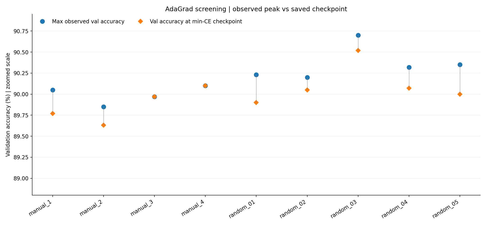
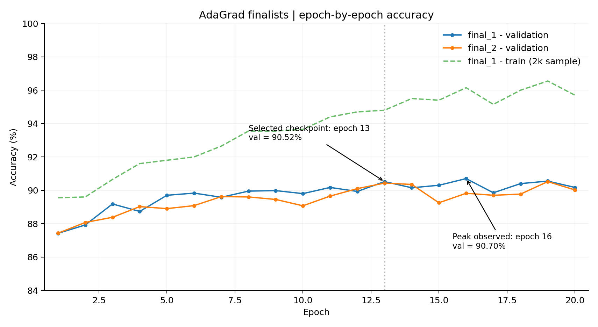
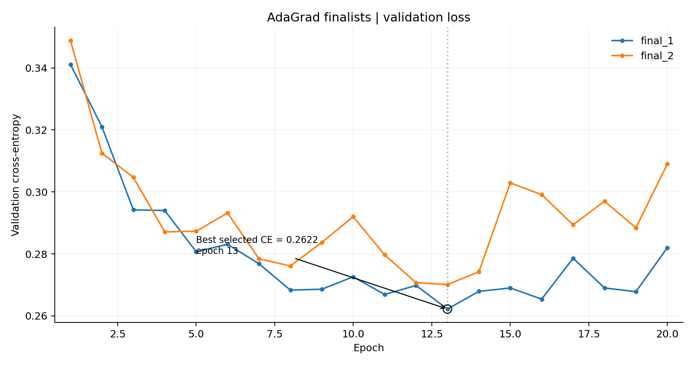

# AdaGrad 수동 탐색·Randomized Search·최종 모델 정리 — `train_adagrad_01.py`

> 6조 Fashion-MNIST 추가 실험. **이 문서의 결과는 검증 데이터 기준이며 테스트 정확도가 아닙니다.**  
> 실행한 파일명: `fashion/train_adagrad_01.py`. 분석 대상 코드는 제공된 원본 `train_adagrad_best.py`를 복사·이름 변경한 버전이며, 아래 수치는 실제 공유된 **전체 학습 터미널 로그**를 바탕으로 정리했습니다.

## 1. 실험 목적과 흐름

기존 팀의 완전연결 신경망을 바탕으로 **AdaGrad**를 고정하고 은닉층 구조, 학습률, L2, Dropout, 배치 크기 등을 조절해 **검증 성능이 높은 단일 모델**을 찾습니다.

1. **수동 탐색:** 4가지 후보를 비교하여 기준 구조 선택 (각 12에폭)
2. **Randomized Search:** 수동 최상위 구조 주변에서 5개 후보 생성·비교 (각 16에폭)
3. **최종 후보 장기 학습:** 상위 2개 후보를 최대 32에폭 학습, 검증 손실 기준 조기 종료
4. **단일 체크포인트 선택·저장:** 최종 검증 성능에 따라 `network_Team6.pkl` 생성
5. **테스트 분리:** 학습·탐색 과정에서는 테스트 데이터 미사용

## 2. 데이터 및 신경망 설정

| 항목 | 설정 |
|---|---|
| 데이터 | 공식 Fashion-MNIST (28×28 의류 이미지, 10개 범주), 픽셀 0~1 정규화 |
| 학습 / 검증 | **54,000장 / 6,000장** (클래스별 600장씩 검증, seed 42) |
| 입력 / 출력 | 784차원 입력 / 10개 출력 |
| 신경망 | `MultiLayerNetExtend` 완전연결 MLP, ReLU, He 초기화 |
| BatchNorm | 모든 은닉층에서 사용 |
| Optimizer | **AdaGrad만 사용** (`common.optimizer.AdaGrad`) |
| 규제 | 후보별 L2·Dropout 설정 변경 |
| 학습 표본 정확도 | 학습용 데이터 중 앞 2,000장에 대해 기록 (`train(sample)`) |
| 검증 지표 | 검증 정확도 및 Cross-Entropy(CE) |
| 에폭별 체크포인트 | **검증 CE가 최소**인 시점의 가중치 및 BatchNorm 상태 보존 |
| 조기 종료 | CE가 충분히 개선되지 않은 에폭이 7회 누적되면 종료 (10에폭 이후) |
| 테스트셋 | 전체 탐색과 모델 저장 과정에서 사용하지 않음 |

공용 `NeuralNet_fashion.py`를 수정하지 않고 AdaGrad를 직접 사용하도록 작성했습니다. 공식 Fashion-MNIST 훈련 원본의 파일 체크섬과 크기를 검사하여 다른 데이터셋 혼입을 방지합니다.

**중요한 선택 기준:** 각 실험에서 최고 정확도 에폭을 저장하는 것이 아니라, **검증 CE 최소 에폭의 가중치를 저장**합니다. 이후 후보 간 순위는 **저장된 체크포인트의 검증 정확도 우선, 동률이면 낮은 CE**로 결정합니다. 따라서 최고 관측 정확도와 최종 저장 정확도가 다를 수 있습니다.

## 3. 수동 탐색 (4개 후보, 각 12에폭)

- 기준 모델: `[480, 288, 144]`에서 시작
- 규제 강도와 은닉층 구조를 바꾸고, 일부 후보에서는 학습률도 함께 변경

| 실험 | 은닉층 | LR | L2 | Dropout | 배치 | 최고 관측 val | 선택 체크포인트(val) | 최소 val CE (에폭) |
|---|---|---:|---:|---:|---:|---:|---:|---|
| `manual_1_no_regularization` | [480, 288, 144] | 0.0100 | 0 | 0.00 | 128 | 90.05% | 89.77% | 0.2823 (7epoch) |
| `manual_2_mild_regularization` | [480, 288, 144] | 0.0080 | 5e-5 | 0.10 | 128 | 89.85% | 89.63% | 0.2755 (7epoch) |
| `manual_3_more_regularization` | [480, 288, 144] | 0.0060 | 1e-4 | 0.20 | 128 | 89.97% | 89.97% | 0.2753 (11epoch) |
| `manual_4_two_hidden` | [576, 288] | 0.0080 | 5e-5 | 0.10 | 128 | 90.10% | 90.10% | 0.2707 (12epoch) |

**해석:** 수동 후보 중 체크포인트 기준 검증 정확도가 가장 높은 것은 `manual_4_two_hidden`의 **90.10%**입니다. 이것은 `[576, 288]`로 은닉층을 줄인 후보이며, 다음 무작위 탐색의 기준 구조가 됩니다. 한편 수동 후보들은 학습률·구조·규제 강도가 동시에 달라지는 경우가 있으므로, 특정 변수 하나의 인과 효과로 단정할 수 없습니다.

## 4. Randomized Search (5개 후보, 각 16에폭)

코드는 수동 탐색 우수 구조를 바탕으로 은닉층 너비에 배율을 주고, 다음 범위에서 후보를 무작위 생성합니다. 이때 난수 시드는 `42 + 2026`이며, 생성된 후보는 `random_plan.json`에 저장됩니다.

| 변경 항목 | 탐색 범위 / 후보 |
|---|---|
| 은닉층 너비 | 수동 우수 모델 너비 × `0.8`, `1.0`, `1.2` (16 단위 반올림 및 상한 640) |
| 학습률 | 약 `0.003` ~ `0.018`에서 로그 균등 추출 |
| L2 | `0`, `1e-5`, `5e-5`, `1e-4`, `3e-4` |
| Dropout | `0`, `0.05`, `0.10`, `0.15`, `0.20`, `0.25` |
| 배치 크기 | `64`, `128`, `256` |

| 실험 | 은닉층 | LR | L2 | Dropout | 배치 | 최고 관측 val | 선택 체크포인트(val) | 최소 val CE (에폭) |
|---|---|---:|---:|---:|---:|---:|---:|---|
| `random_01` | [640, 352] | 0.0074165 | 1e-4 | 0.25 | 128 | 90.23% | 89.90% | 0.2646 (13epoch) |
| `random_02` | [640, 352] | 0.0046919 | 0 | 0.15 | 64 | 90.20% | 90.05% | 0.2651 (15epoch) |
| `random_03` | [640, 352] | 0.0075704 | 5e-5 | 0.15 | 64 | 90.70% | 90.52% | 0.2622 (13epoch) |
| `random_04` | [464, 224] | 0.012944 | 1e-5 | 0.15 | 128 | 90.32% | 90.07% | 0.2662 (14epoch) |
| `random_05` | [640, 352] | 0.004546 | 5e-5 | 0.00 | 64 | 90.35% | 90.00% | 0.2725 (11epoch) |



**주요 결과:** `random_03`은 학습 중 **90.70%(16에폭)**를 기록했으며, 검증 CE가 가장 낮았던 **13에폭 체크포인트의 정확도는 90.52%, CE는 0.2622**입니다. 무작위 후보 가운데 선택 체크포인트 기준으로 가장 좋은 결과였습니다.

## 5. 최종 후보 장기 학습 (최대 32에폭)

수동·무작위 탐색을 통합해 우수한 2개 설정을 다시 학습했습니다. 실제로는 **두 후보 모두 20에폭에서 조기 종료**되었습니다.

| 실험 | 은닉층 | LR | L2 | Dropout | 배치 | 최고 관측 val | 선택 체크포인트(val) | 최소 val CE (에폭) |
|---|---|---:|---:|---:|---:|---:|---:|---|
| `final_1` | [640, 352] | 0.0075704 | 5e-5 | 0.15 | 64 | 90.70% | 90.52% | 0.2622 (13epoch) |
| `final_2` | [576, 288] | 0.0080 | 5e-5 | 0.10 | 128 | 90.52% | 90.43% | 0.2701 (13epoch) |

### 검증 정확도 추이



- `final_1`: 13에폭 **val 90.52%**, 검증 CE **0.2622** (최종 저장에 선택)
- `final_1`: 16에폭에 **val 90.70%**로 더 높은 순간 정확도를 기록했으나 CE는 **0.2654**로 13에폭보다 높았습니다.
- `final_2`: 최고 순간 검증 정확도 **90.52%(19에폭)**, 하지만 CE 최소인 **13에폭에는 val 90.43%, CE 0.2701**입니다.
- 학습 표본 정확도가 계속 높아져도 검증 지표는 오르내려, 추가 에폭이 항상 일반화 성능을 개선하지는 않았습니다.

### 검증 손실(CE) 추이



검증 CE가 더 이상 안정적으로 개선되지 않으면 조기 종료되도록 했습니다. 최종 모델은 **13에폭에서 저장된 `final_1` 체크포인트**입니다.

## 6. 선택된 단일 AdaGrad 모델

| 항목 | 최종 선택 결과 |
|---|---|
| 모델명 | `final_1` (Randomized Search의 `random_03` 설정 재학습) |
| 구조 | **`784 → 640 → 352 → 10`** |
| 은닉층 수 | 2개 |
| Optimizer | AdaGrad |
| 초기 학습률 | `0.007570421412086942` |
| L2 가중치 감소 | `5e-5` |
| Dropout | `0.15` |
| 배치 크기 | `64` |
| 선택된 에폭 | **13** (검증 CE 최소) |
| **선택된 체크포인트 검증 정확도** | **90.52%** |
| **선택된 체크포인트 검증 CE** | **0.2622** |
| 학습 중 최고 순간 검증 정확도 | 90.70% (16에폭, 최종 저장 에폭과 다름) |
| 테스트 평가 | **미실시** |

실행 당시 저장 위치는 다음과 같습니다.

```text
fashion/adagrad_runs/full_20261111_003028_470289/Competition/network_Team6.pkl
```

**주의:** 위 `.pkl`은 사용자 PC의 로컬 실험 폴더에 저장된 파일입니다. 이 보고서에 포함되거나 GitHub에 자동으로 업로드된 것은 아닙니다. 원본 모델을 팀 최종 제출물로 사용할지는 다른 후보와 검증한 다음 결정해야 합니다.

## 7. 실행 방법과 자동 생성 산출물

저장소 루트(`C:\Neural_Net\team_github`)에서:

```powershell
python fashion/train_adagrad_01.py --quick
python fashion/train_adagrad_01.py --full
```

- `--quick`: 작은 데이터셋(학습 2,000장, 검증 400장)으로 기능 점검만 수행하므로 최종 성능이 아닙니다.
- `--full`: 위 수동 비교 → 무작위 탐색 → 장기 학습 → 단일 체크포인트 저장을 수행합니다.
- 재개 시에는 **실제로 저장한 파일명**인 `train_adagrad_01.py`를 사용합니다. 코드 내부의 일부 안내 문구가 원래 파일명인 `train_adagrad_best.py`로 출력될 수 있습니다.

```powershell
python fashion/train_adagrad_01.py --resume "C:\Neural_Net\team_github\fashion\adagrad_runs\full_20261111_003028_470289"
```

전체 실행은 로컬 결과 폴더에 `plan.json`, `manual_results.csv`, `all_screening_results.csv`, `final_results.csv`, `selection.json`, 각 후보별 `history.csv`·`result.json`·`best_model.pkl`, 선택된 모델의 `accuracy.png`·`loss.png` 등을 저장합니다.

**이 문서의 그래프**는 공유된 터미널 로그를 토대로 별도로 작성했으며, 에폭별 숫자는 [`report_assets/adagrad_epoch_log_from_console.csv`](report_assets/adagrad_epoch_log_from_console.csv)에 첨부했습니다. 로그는 정확도 소수 둘째 자리(%)·CE 소수 넷째 자리로 반올림되어 있으므로 원본 `history.csv`와 미세하게 다를 수 있습니다.

## 8. 결과 해석과 한계

1. **수동 탐색 → Randomized Search의 흐름이 확인됩니다.** 기존 설정을 기준으로 후보를 확장하고, 동일한 검증 데이터로 선택했습니다.
2. **정규화/모델 크기 비교:** 두 은닉층 구조가 좋은 결과를 보였지만 학습률·규제·너비가 함께 바뀌어 단일 요인 효과로 단정할 수 없습니다.
3. **과적합 관리:** `final_1`은 학습 표본 정확도가 높아지는 동안 검증 CE가 개선되지 않는 구간이 있어, 20에폭에 조기 종료했습니다.
4. **검증 정확도와 CE 구분:** 학습 중 최고 관측 정확도는 90.70%이나, 실제 선택된 모델은 검증 CE 0.2622를 기록한 13에폭의 **90.52%**입니다. 보고서에서 두 숫자를 혼동하지 않아야 합니다.
5. **기존 팀 Adam 결과와 비교 시 주의:** 팀 README에 기록된 **검증 91.28% / 테스트 90.86%**는 다른 학습 설정·데이터 분할에서 얻어졌을 수 있어, 이 실험의 90.52%와 단순 비교하여 최종 우열을 단정할 수 없습니다. 이 실험의 **테스트 정확도는 아직 없습니다.**
6. **최종 제출 절차:** 팀 합의 후 검증 데이터 기준으로 최종 모델을 선정하고, 시험 데이터는 그 모델의 최종 평가에만 사용해야 합니다.

## 9. 자료 근거

- 실제 제공된 `train_adagrad_best.py` 원본의 함수·설정값과, 사용자가 `train_adagrad_01.py`로 저장해 실행한 기록
- 전체 학습 로그: `full_20261111_003028_470289` (수동 4, Random 5, 최종 2; 총 168개 에폭별 행)
- 최종 저장 결과: `final_1`, 13에폭, 검증 정확도 **90.52%**, 검증 CE **0.2622**, 테스트 미실시
- 모든 그래프 및 요약 수치는 **해당 실행 로그에서 산출**했으며, 새로운 학습을 통해 추정한 수치는 아닙니다.
